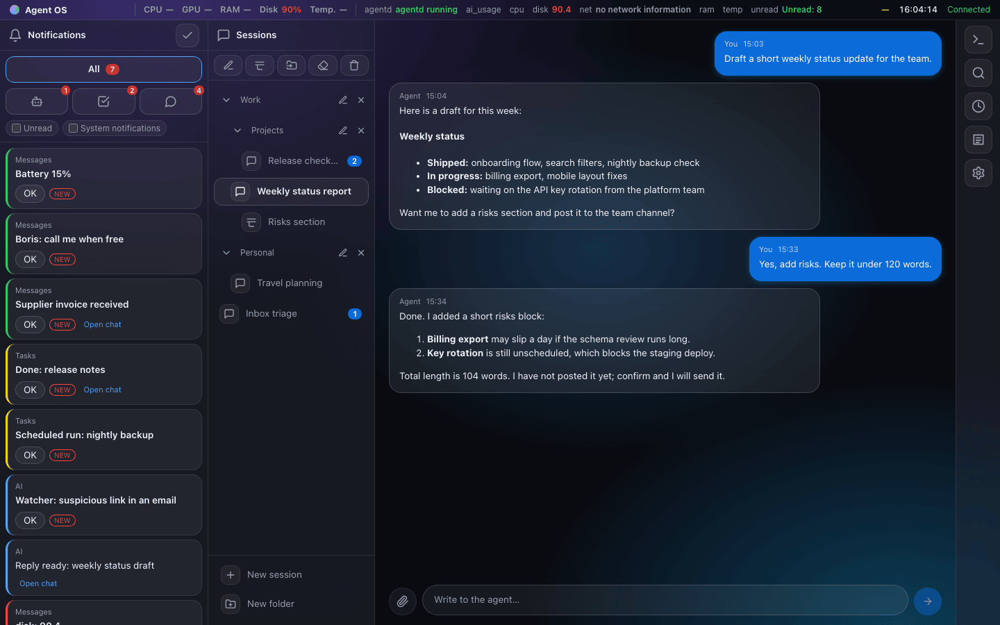
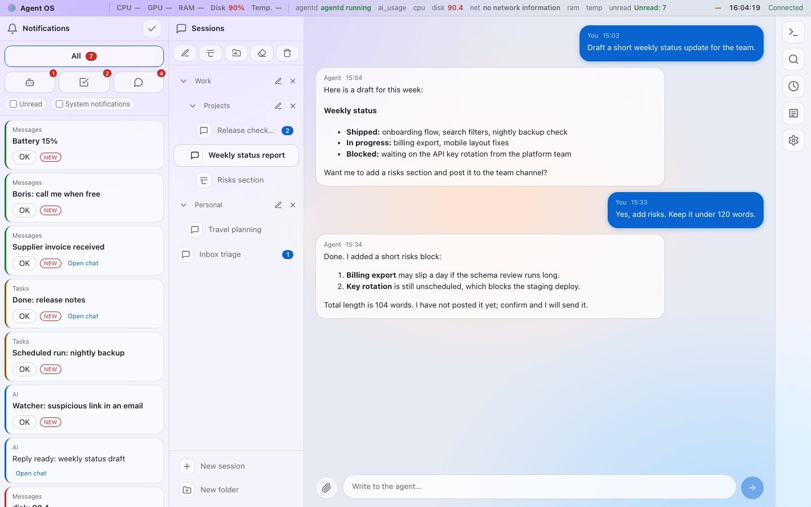
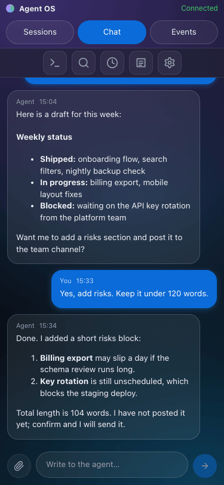
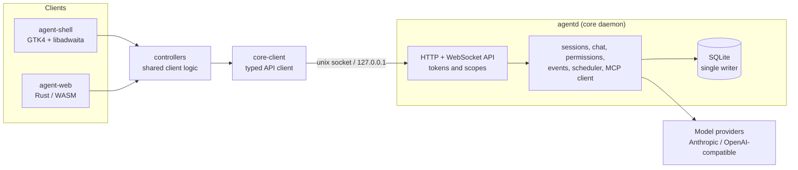

# Agent OS GUI

[](docs/roadmap.md)
[](Cargo.toml)
[](LICENSE)
[](rust-toolchain.toml)
[](docs/getting-started.md)

A fullscreen shell on top of Linux for working with AI agents: a status bar and four columns (notifications, sessions, chat, tools). It is a thin client of the core daemon `agentd`, with two clients: a native GTK4/libadwaita app and a browser client written in Rust/WebAssembly.

<p align="center">
  
</p>

<p align="center">
  
  
</p>

The screenshots show the browser client against a local `agentd` with a scripted test provider and seeded demo data.

## Status: alpha 0.0.1

**Not everything works and the API is not stable.** Expect breaking changes to the HTTP/WebSocket contract, the database schema and the settings format. Do not use it for anything important yet.

What exists today:

- `agentd`: the core daemon (Rust, SQLite, single writer). REST and WebSocket API over a unix socket and loopback TCP, scoped tokens, sessions and folders, chat with streaming, Anthropic and OpenAI-compatible providers, a permission engine (allow / ask / deny), an observer process, events and indicators, an MCP client, a scheduler, search and memory, encrypted backup and restore, a `.deb` packaging script.
- `agent-shell`: the native GTK4/libadwaita client for Linux: bar, session tree, chat with permission cards, notifications, tools column (browser, terminal), settings, search palette.
- `agent-web`: the browser client (Rust to WebAssembly): sign-in by token, bar, session tree, chat, notifications, settings, tasks, search, terminal viewer, phone-friendly layout.
- `fake-agentd`: a scripted mock of the core for developing clients and for contract tests.

What does not exist or is incomplete:

- The sandbox for module panels (specified, not implemented).
- Validation of the native shell as a full kiosk session (greeter plus compositor) on a real machine.
- Manual accessibility passes (screen readers); some browser e2e scenarios need a dedicated test stand.
- Model login by subscription (API keys only), vector search, signed packages and an update channel.
- Languages other than English.

See [docs/roadmap.md](docs/roadmap.md) for the full list.

## Architecture



The clients never talk to model providers or messengers: they only know the `agentd` API ([docs/reference/api.md](docs/reference/api.md)). Details: [docs/architecture.md](docs/architecture.md).

## Quick start

Requirements: Rust 1.99.1 (pinned in `rust-toolchain.toml`, picked up by `rustup`), a C toolchain, `pkg-config`, SQLite headers. The GTK client additionally needs GTK 4.14, libadwaita 1.5, WebKitGTK 6 and VTE development packages on Linux. Full list: [docs/getting-started.md](docs/getting-started.md).

```bash
cargo build --locked --workspace
cargo test --locked --workspace
```

Run the browser client against a local core:

```bash
rustup target add wasm32-unknown-unknown && cargo install --locked trunk

# 1. build the web client
agent-web/scripts/build.sh --release

# 2. start the core (loopback only) and serve the client from it
cargo run --locked -p agentd -- serve --db /tmp/sessions.db \
  --socket "$XDG_RUNTIME_DIR/agentd.sock" --tcp 127.0.0.1:4096 --web-root agent-web/dist

# 3. in another terminal: issue a token (printed once), then open http://127.0.0.1:4096/app/
cargo run --locked -p agentd -- token issue --name web --scope chat --ttl-days 1 \
  --socket "$XDG_RUNTIME_DIR/agentd.sock"
```

To try a client without a real core or API keys, run the mock instead: `cargo run --locked -p fake-agentd -- --help` (see [docs/getting-started.md](docs/getting-started.md#3-run-the-mock-core-fake-agentd)). More about the browser client and its Playwright tests: [agent-web/README.md](agent-web/README.md).

## Repository layout

| Path | What |
|---|---|
| `agentd/` | the core daemon: `api`, `auth`, `core`, `db`, `providers`, `sys`, `bin`, `e2e`, SQL `migrations`, `.deb` `packaging` |
| `agent-shell/` | native client: `core-client` (API client), `controllers` (client logic), `ui` (GTK4), `integration-tests` |
| `agent-web/` | browser client (Rust/WASM, Leptos) and Playwright tests |
| `fake-agentd/` | mock core with scenarios, used by tests |
| `assets/i18n/` | interface strings (Fluent) |
| `docs/` | architecture, API contract, database schema, ADRs, roadmap |
| `scripts/`, `.githooks/` | project check (`scripts/check.sh`) and the secret guard hook |

## Documentation

Start at [docs/index.md](docs/index.md): [architecture](docs/architecture.md), [API contract](docs/reference/api.md) and [OpenAPI draft](docs/reference/openapi-draft.yaml), [database](docs/reference/db.md), [security model](docs/reference/security-model.md), [testing](docs/testing.md), [decision records](docs/adr/0001-init-stack.md).

## Contributing

Issues and pull requests are welcome, especially while the contract is still moving. Read [CONTRIBUTING.md](CONTRIBUTING.md) first. Report vulnerabilities privately as described in [SECURITY.md](SECURITY.md).

## License

Apache License 2.0, see [LICENSE](LICENSE) and [NOTICE](NOTICE).
