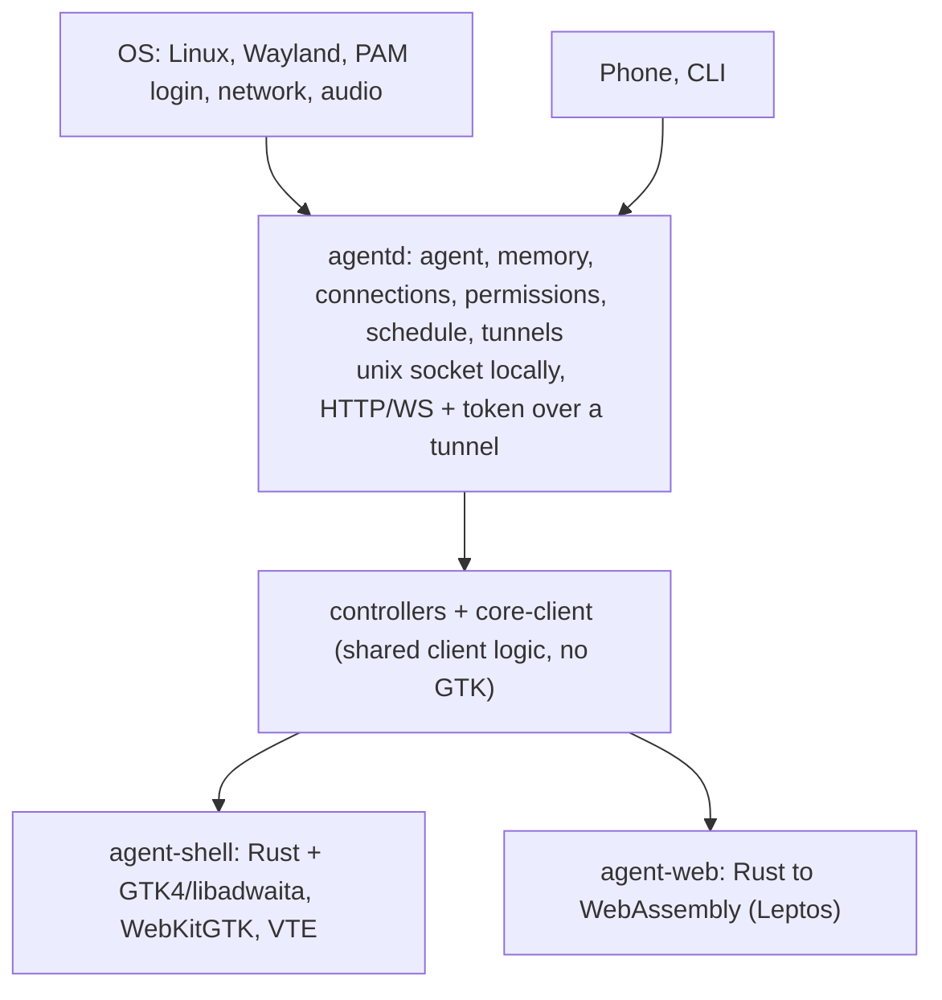
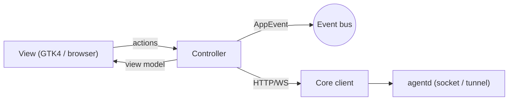
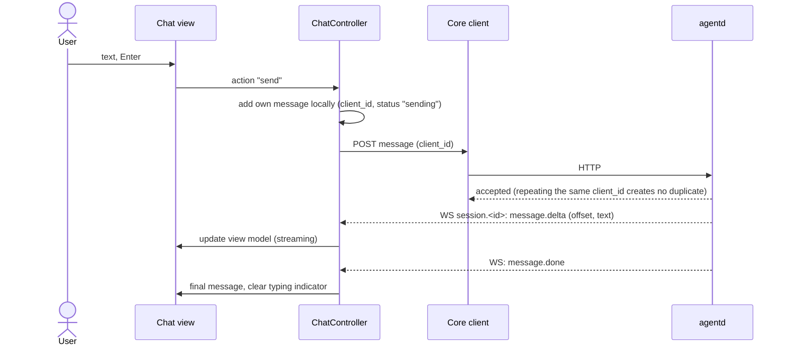
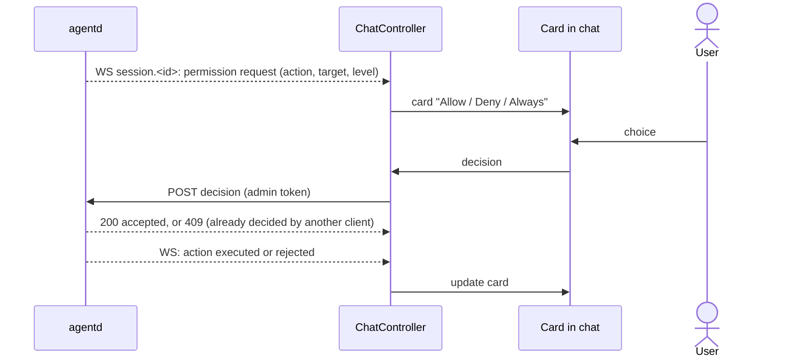
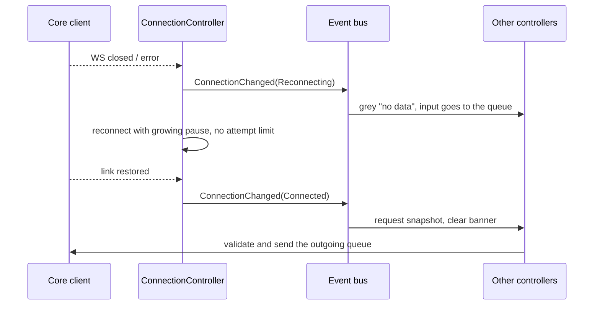
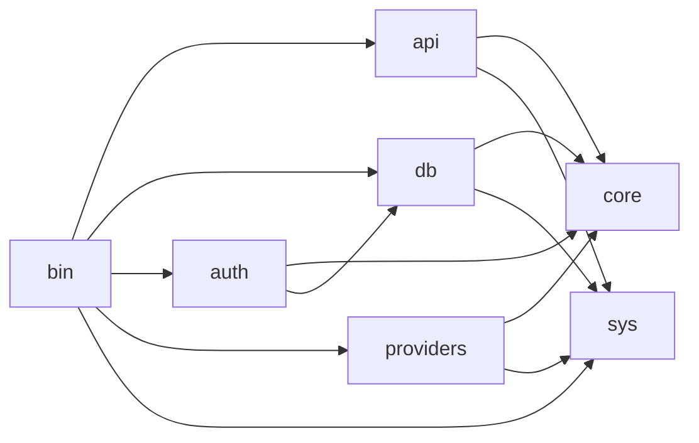
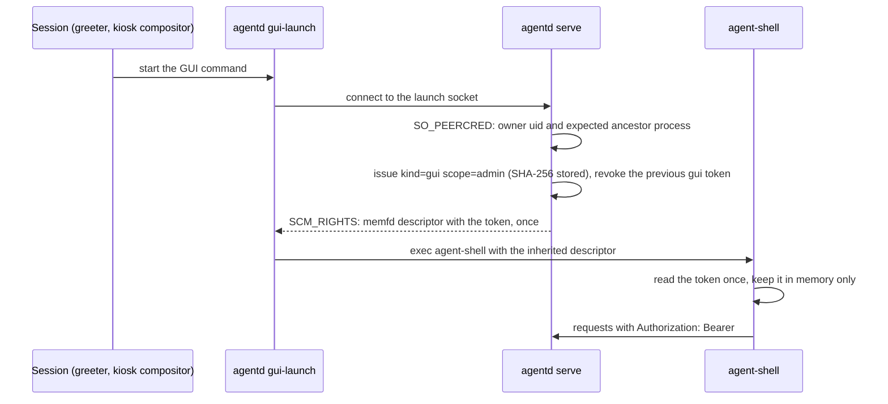
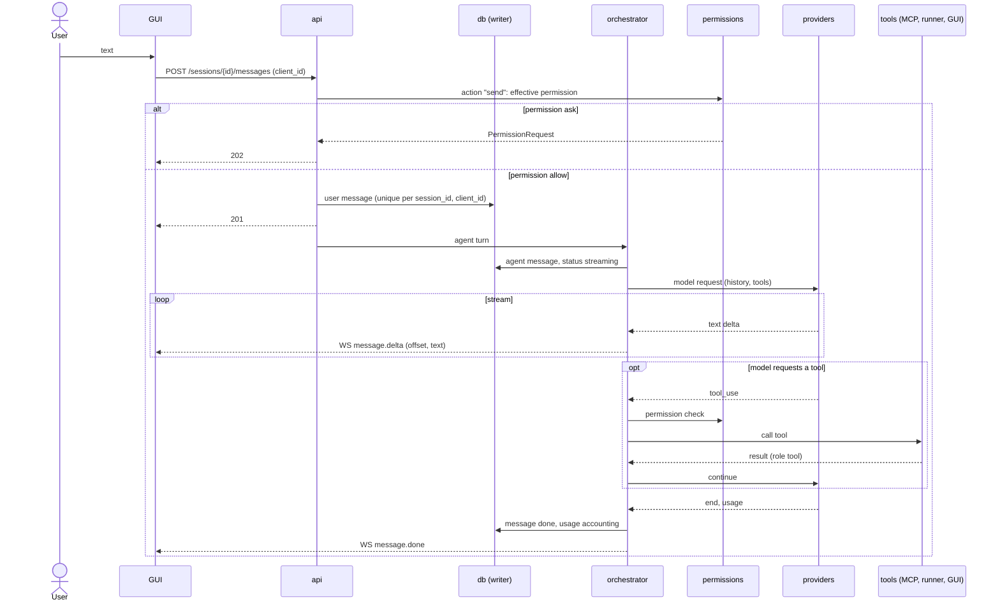
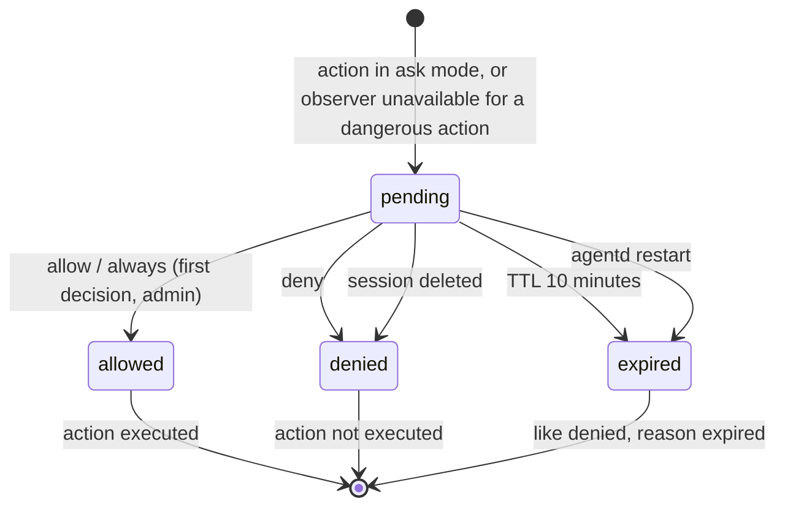

# Architecture

Status: pre-alpha (0.0.1-alpha). This document describes the layers, the client controllers, the core daemon `agentd` and the main data flows. Where a statement is a design intent rather than something verified in code, it is marked "planned".

Related: [code map](reference/code-map.md), [API contract](reference/api.md), [database](reference/db.md), [security model](reference/security-model.md), [testing](testing.md), [ADRs](index.md#decisions-adr).

## 1. Layers



| Layer | What | Stack |
|---|---|---|
| OS | kernel, drivers, network, audio, PAM | as is (Ubuntu is the target) |
| Core `agentd` | daemon, the single source of data | Rust, HTTP/WS, SQLite |
| Client logic | `controllers` and `core-client` crates, no GTK | Rust |
| GUI `agent-shell` | thin client of the core, fullscreen Wayland shell: bar and four columns | Rust, GTK4, libadwaita, WebKitGTK, VTE |
| Browser client `agent-web` | same contract, runs in a browser against a local or tunneled `agentd` | Rust to wasm32, Leptos |

The GUI knows nothing about models, messengers, mail or concrete providers. It speaks only the core API: HTTP for commands, WebSocket for subscriptions. Everything provider-specific (icon, label, event subtype, account name) arrives as data from the core. Helper daemons (observer, gateway, runner and so on) are invisible to the GUI; the core aggregates their data.

## 2. Client boundaries

- **Transport and authentication ([ADR-0003](adr/0003-api-auth.md)).** Locally the client uses a unix socket (`$XDG_RUNTIME_DIR/agentd.sock`). A token is always required, including on the socket. Scopes are `read`, `chat`, `admin`. The GUI receives its `admin` token at launch as an inherited file descriptor (`agentd gui-launch`), not from a file or the environment, and keeps it in process memory only. External clients use TCP on `127.0.0.1:4096` through a tunnel with the same tokens, with an expiry and revocation, `Origin` and `Host` checks; only `GET /health` is anonymous.
- **One API for every client.** The browser client, the phone and the CLI use the same API; the difference is the token kind and scope, not a special path.
- **What the client stores.** Only layout and a theme cache in `$XDG_CONFIG_HOME/agent-shell/ui.json`. Sessions, history, permissions, settings and events live in the core database (`sessions.db`, see [db.md](reference/db.md)). The GUI can be restarted at any time without data loss: it restores everything from a snapshot.
- **All user and external text is escaped** before display (see the security section below).
- **Memory source.** The core decides where memory and search come from (`local`, an external MCP server, or both; [ADR-0009](adr/0009-memory-via-mcp.md)). The client only calls `GET /search` and receives the result source as data.

## 3. Shell components

```
+ Bar 24px ---------------------------------------------------+
+ Notifications | Sessions |      Chat       | Tools ---------+
|  300 / 56px   | 236/64px | flexible >=480px|  560 / 56px    |
+-------------------------------------------------------------+
        + dialogs (create, Settings up to 90% of the window)
```

| Component | Content |
|---|---|
| Bar | Agent OS menu, AI account quotas, system metrics, extra indicators, weather, date, clock |
| Notifications column | three-level filters, cards, a thin strip when collapsed |
| Sessions column | tree of folders, sessions and threads |
| Chat column | persona and folder chips, messages, input, permission cards |
| Tools column | browser (WebKitGTK), terminal (VTE), session settings, modules; visible only with an open session |
| Dialogs, toast | create session/folder/thread, Settings, confirmations; a 4 s toast |

Columns auto-collapse by window width (tools below 1576 px, notifications below 1072 px); the chat column is never narrower than 480 px.

## 4. Controller principles

1. **One state owner per area.** Notification state belongs to `NotificationsController`, the session tree to `SessionTreeController`, and so on. Others read it only through events.
2. **Controllers do not know each other.** They communicate through a typed event bus. No direct calls between controllers.
3. **The view knows nothing about the API.** The view receives a view model from its controller and hands user actions back. HTTP, WebSocket and the token are visible only to the core client.
4. **Identifiers, not indexes.** Selection is stored as `session_id`, `event_id`, `folder_id`, never as an array index.
5. **Core state is synchronized by subscription.** After a reconnect a controller requests a snapshot and then applies deltas.
6. **Controllers are testable without a GUI**: the core client and the bus are replaced in tests ([testing](testing.md)).



### 4.1 Event bus

The bus is internal to the `controllers` crate and is **not** the core's WebSocket topics. WebSocket frames reach the core client, a controller turns them into a change of its own model and, if needed, publishes a typed `AppEvent` (session open, new notification, connection change, theme change, layout change, open settings, shortcut, toast). There are no string topics or JSON on the bus.

Delivery rules: FIFO per subscriber; delivery is not recursive (a handler is never called inside `publish`); worker threads publish only through the main-loop channel.

### 4.2 Controller and view model

Each area has one immutable **view model**: a snapshot of what must be drawn. The view subscribes to model changes and returns user actions. A controller has three inputs: view actions, core messages and bus events.

```rust
pub trait Controller {
    type Model: Clone + PartialEq;
    type Action;
    fn model(&self) -> &Self::Model;
    fn on_action(&mut self, a: Self::Action, ctx: &mut Ctx);
    fn on_core(&mut self, m: CoreMsg, ctx: &mut Ctx);
    fn on_event(&mut self, e: &AppEvent, ctx: &mut Ctx);
}
```

`Ctx` gives the controller the core client, the bus and a clock (all replaceable in tests). The exact signatures live in `agent-shell/controllers/src/controller.rs`.

### 4.3 Concurrency

- The GTK main loop is single-threaded; views, controllers and the bus live there.
- The core client runs on a separate `tokio` runtime in a worker thread: HTTP, WebSocket, reconnect, the outgoing queue.
- Bridge: `tokio` to the main loop through a channel; commands go back through `mpsc`. Controllers never block the main loop and never call `tokio` directly.
- Each WebSocket frame is delivered in order. A snapshot after a reconnect replaces the model, then deltas (`seq`, `offset`; see [api.md](reference/api.md)) are applied.
- Timers (bar clock, reconnect pauses) go through the shared clock in `Ctx` so tests control time.

## 5. Controllers

| Controller | Responsibility |
|---|---|
| `ShellController` | startup, four-column layout, collapsing, current session, tools column visibility |
| `BarController` | bar assembly, Agent OS menu (About, Settings, Logout), clock, date, weather |
| `QuotaController` | usage accounting per provider account (tokens and cost from `usage`, API-key rate limits, local model load); forecast "runs out in" only when remaining quota and reset time are known |
| `MetricsController` | CPU, GPU, RAM, disk, temperature and colour thresholds |
| `IndicatorController` | extra bar indicators (network, battery, units, messages), grey when no data, collapse by priority; transition state is kept by the core |
| `NotificationsController` | event list, three-level filters, unread counters, window title `(N) Agent OS` |
| `SessionTreeController` | tree of folders, sessions and threads; create, move, rename, delete; persona inheritance; unread badges |
| `ChatController` | session messages, input, Markdown, streaming, stop, persona and folder chips, permission (`ask`) and observer cards, sending with `client_id` |
| `ToolsController` | session tool tabs, collapsed strip |
| `BrowserController` | address bar, navigation, bookmarks, a profile per session, browser actions by the agent under the `browse` permission |
| `TerminalController` | user terminal (VTE) in the session folder; the agent's commands are executed by the **core**, the GUI only shows their output in a read-only panel |
| `SessionSettingsController` | context, model, per-session permissions (tightening only), behaviour, actions |
| `ModulesController` | module panels, bar widgets and buttons from a manifest; each panel in its own web context ([ADR-0004](adr/0004-modules-sandbox.md)) |
| `SettingsController` | the Settings dialog, one sub-controller per page, real saving through the API |
| `DialogController` | modal windows and confirmations that list what will be lost |
| `SearchController` | `Super+K` (and `Ctrl+K` outside terminal and browser): one search over sessions, messages, files and memory |
| `ConnectionController` | link state, banners, reconnect, the outgoing queue, resync |
| `ThemeController` | auto, dark or light theme; the core is the source of truth, `ui.json` is a cache |
| `ShortcutController` | global shortcuts, published to the bus |

Which of these are fully implemented and which are still stubs is listed in the [code map](reference/code-map.md) and the [roadmap](roadmap.md).

### Settings pages

Account, About, Personas, Models, Connections, Permissions, Security, Schedule, Modules, Tunnels, Files, Bar indicators. Personas, permissions, modules, tunnels and indicators live in the core database; JSON files under `~/.agentos/` are read-only exports and the GUI never reads or writes them. API secrets are write-only (`PUT /secrets/{ref}`) and can never be read back.

## 6. Data flows

### 6.1 Sending a message



Deltas are applied only when `offset` equals the length of the text already accumulated; after a reconnect the controller takes a snapshot (`seq`) and continues from it.

### 6.2 Reply in an inactive session

The core publishes an `events` frame and a `sessions` frame. `SessionTreeController` increments the unread badge, `NotificationsController` adds a card and publishes `NotificationNew` on the bus, and `ShellController` shows a 4 second toast.

### 6.3 Permission request (`ask`)



- **First decision wins.** A repeated decision receives `409`.
- **"Always"** never weakens the session level; it creates or changes a persona or global rule ([ADR-0005](adr/0005-permissions-semantics.md)).
- A request expires after a TTL (10 minutes) and is treated as denied.
- **Fail-closed.** If the observer is unavailable, dangerous actions are not executed and the card says the check is unavailable.
- Only a local GUI token with `admin` (or a browser token with the `decide` scope, see [ADR-0010](adr/0010-web-client.md)) may decide.

### 6.4 Connection loss



Link states: `connecting`, `connected`, `reconnecting` (retries without limit, pause capped at 30 s), `offline`, `core_unavailable` (the `agentd` unit does not start, see [ADR-0006](adr/0006-kiosk-safety.md)). Each queued outgoing item has a TTL and is revalidated before sending: if the session was deleted or permissions changed, it is not sent and the user sees the list of cancelled items. Sending uses `client_id`, so a retry creates no duplicate.

### 6.5 Settings conflicts

Settings changes use `If-Match: <rev>`. On `412` the GUI re-reads the page and offers to repeat the edit on fresh data.

## 7. Client security

- Every user, agent and external string is escaped before display. In GTK, labels use `set_use_markup(false)`; where Pango markup is needed every external fragment passes `glib::markup_escape_text` first. In the browser client HTML insertion APIs are forbidden by lint configuration (`clippy.toml`) and text enters the page only as text nodes.
- Chat messages are rendered as limited Markdown (code, lists, links) without embedded HTML or scripts.
- Only `http`, `https` and `mailto` link schemes are allowed; links open on an explicit click and the full address is shown.
- External pages open only inside a WebKit container with a separate profile per session; module panels have their own contexts and a CSP ([ADR-0004](adr/0004-modules-sandbox.md)).
- Secrets are never shown, logged or put into chat. Dangerous actions go through permissions and the observer; the GUI only shows the request and passes the user's decision.
- The effective permission is the strictest of three levels (global, persona, session); a lower level can only tighten.

## 8. Core `agentd`

`agentd` is the single source of data and the only writer of `sessions.db` ([ADR-0002](adr/0002-db-single-writer.md)). It hosts the agent orchestrator, model providers, the MCP client, the permission engine, the scheduler, usage accounting and the API for the GUI, the browser client, a phone and the CLI.

### 8.1 Processes

| Process | Where | Notes |
|---|---|---|
| `agentd serve` | `systemd --user` | main process: API, database, orchestrator, providers, MCP client, permissions, scheduler, metrics |
| `agentd watch` | socket-activated service | the observer, a separate process on purpose: it runs a local model, never sees keys and its unavailability must fail closed |
| `agentd runner` | system service (root), socket activation | executes agent commands as a dedicated unprivileged user ([agentd-A-0006](adr/agentd-A-0006-runner-packaging.md)) |
| `agentd gui-launch` | started by the session | issues the GUI token as a descriptor and starts `agent-shell` |

The scheduler and system metrics run inside `agentd` ([agentd-A-0004](adr/agentd-A-0004-scheduler-in-process.md)). Backup, restore and diagnostics are subcommands of the same binary.

### 8.2 Crates



| Crate | Responsibility |
|---|---|
| `agentd-core` | domain types, ports (traits such as store, provider, tool host, clock), pure rules (effective permission), orchestrator, permission engine, observer protocol, gateway, MCP client, indicators, scheduler logic |
| `agentd-db` | one writer thread, a reader pool, migrations, repositories, backup and integrity checks |
| `agentd-api` | HTTP and WebSocket: routes, authentication, topics, hub, error envelope, request id |
| `agentd-auth` | token issue and verification (SHA-256 at rest), token kinds |
| `agentd-providers` | Anthropic and OpenAI-compatible providers, SSE parsing, usage and rate-limit headers, MCP transports, channels, weather |
| `agentd-sys` | the small set of safe system calls (descriptor passing, metrics) |
| `agentd` (bin) | wiring, CLI subcommands, systemd integration, packaging |
| `agentd-e2e` | end-to-end tests against a real process |

Dependency direction points to `core` (`api` does not depend on `db` or `auth`; it talks to them through ports); `bin` injects port implementations. The workspace forbids `unsafe_code` (the only exception is `agent-shell/ui/src/hardening.rs`). Code under test is not mocked: tests substitute separate implementations of the ports.

### 8.3 Single database writer

One dedicated OS thread owns the only write connection. Other code sends typed commands through a bounded channel and waits for the answer. A command runs in one transaction together with its side writes (action log, feed event, indicator state). Readers use a read-only pool. PRAGMAs: `journal_mode = WAL`, `synchronous = NORMAL`, `foreign_keys = ON`, `busy_timeout = 5000`; the schema version is set only by the migration runner. Streaming messages are written in batches with `status = streaming`; the in-memory hub buffer, not the database, is the source of truth for `message.delta.offset`. At startup `streaming` messages become `interrupted` and pending permission requests are closed as expired.

### 8.4 Token lifecycle and GUI launch

The `api_token` table stores only SHA-256 hashes and metadata; the raw value is shown once. Kinds: `gui` (`admin`, valid until the GUI process stops), `external` and `web` (not above `chat`, with expiry), `agent` and `module` (`chat` or lower with a mandatory method allowlist), `test` (test builds only). A token in a URL is rejected with `401`.



The token is not in the environment, command line or any file. Install requirement: `kernel.yama.ptrace_scope=1`.

### 8.5 Request pipeline in `api`

1. `X-Request-Id` (UUID v7) is accepted or generated and returned in every response and error.
2. TCP only: `Origin` and `Host` allowlist (`403 forbidden_origin`) and a failed-attempt limiter (5 per minute per address, `429` with `Retry-After`).
3. Unix socket only: `SO_PEERCRED` must match the daemon's owner.
4. A token in the URL is rejected; `Authorization: Bearer` is parsed, looked up by hash, expiry and revocation are checked.
5. Route scope and "local only" flag are enforced.
6. For `agent` and `module` tokens the method and path are matched against the allowlist.
7. The handler calls a service; mutations whose permission is `ask` answer `202` with a `PermissionRequest`.
8. `GET /v1/health` is anonymous; while migrating, other routes answer `503 migrating`.

WebSocket upgrade on `/v1/ws` follows the same rules; revoking a token closes the connection with code `4401`, insufficient scope with `4403`.

### 8.6 Chat with streaming (core side)



A repeated `client_id` returns the stored message. `POST /sessions/{id}/stop` cancels a turn (status `stopped`). All text from external sources (mail, pages, tool results) is marked `untrusted` and can neither grant permissions nor change rules. The agent's terminal commands run in the core through `agentd runner`; the browser tool is a `browser.command` event to the GUI with the result posted back through `tool-results`.

### 8.7 Permission request states



A second answer after a transition returns `409 conflict`. A policy of `deny` creates no request and returns `403 permission_denied` immediately.

### 8.8 Schedule

The scheduler sleeps until the nearest `next_run` among active tasks (or until a change signal), records a `task_runs` row, runs an agent turn in the task's session on behalf of a persona (permissions work as in a normal turn) and writes a feed event. Cron expressions are evaluated in the task's time zone; `next_run` is stored in UTC. Triggers fire on incoming gateway events instead of a timer ([agentd-A-0004](adr/agentd-A-0004-scheduler-in-process.md)).

### 8.9 Feed events

An incoming message or an indicator transition is checked by the observer (injection and phishing for inbound mail and chats), then one transaction writes the gateway message, the indicator state, the feed event (with a dedup key) and observer findings. The hub then publishes to the `events`, `sessions` and `bar.indicators` topics. Every indicator transition produces an event; the core keeps the state.

### 8.10 Concurrency in the core

| Task | Model |
|---|---|
| Runtime | one multi-threaded `tokio` runtime |
| Listeners | unix socket and (optional) TCP on `127.0.0.1:4096`; one router for both |
| DB writes | one OS thread, bounded channel; a full channel applies backpressure |
| DB reads | `spawn_blocking` with a reader pool |
| Agent turn | one task per active session turn, global semaphore `max_parallel` |
| Provider stream | one task per request, cancelled through a `CancellationToken` |
| WebSocket hub | topic registry, bounded queue per subscriber; a lagging client gets a `seq` gap and resyncs from a snapshot |
| Shutdown | `SIGTERM`: close listeners, cancel turns (`interrupted`), close WebSockets with `1001`, wait for the writer |

Errors use one envelope `{error: {code, message, details, retryable, request_id}}`; an internal error never leaks details to the client. Logs go through `tracing` and never contain message text, tokens or keys.
