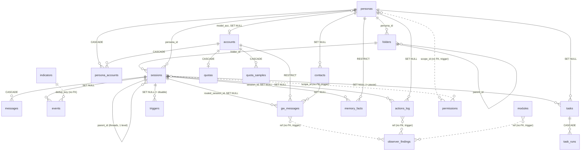

# Agent OS database architecture

> Status: **design**; the migrations `0001` to `0010` live in `agentd/migrations/` (the source of truth); the mock embeds the shared ones from there via `include_str!`, keeps its own copies of `0003`–`0005` in `fake-agentd/migrations/`, and the runner is `fake-agentd/src/db/migrate.rs`. The schema is derived from the GUI needs (sessions, folders, personas, events, accounts, balance, quota). Decisions: the single writer is [ADR-0002](../adr/0002-db-single-writer.md), API authentication is [ADR-0003](../adr/0003-api-auth.md), permissions are [ADR-0005](../adr/0005-permissions-semantics.md). Other decisions: stack and forks [ADR-0001](../adr/0001-init-stack.md), modules [ADR-0004](../adr/0004-modules-sandbox.md), kiosk [ADR-0006](../adr/0006-kiosk-safety.md), distribution and backup keys [ADR-0007](../adr/0007-distribution-and-backup-keys.md), closed 0.1 questions [ADR-0008](../adr/0008-open-questions-closed.md), memory via the `memory_mcp` MCP server [ADR-0009](../adr/0009-memory-via-mcp.md).

## 1. What is stored where

| Store | What | Owner | Format | FS permissions |
|---|---|---|---|---|
| `~/.agentos/sessions.db` | sessions, threads, history, events, personas, permissions, log, tasks, modules, memory (facts) | `agentd` | SQLite, WAL | `0600` (also `-wal`, `-shm`); the directory `~/.agentos` is `0700` |
| `~/.agentos/index.db` | RAG index: embeddings of mail, chats, files | `agent-index` | SQLite + `sqlite-vec` | `0600` |
| `~/.agentos/*.json` | `config.json`, `permissions.json`, `connections.json`, `personas.json`, `modules.json`, `tunnels.json` | `agentd` | JSON, **export from the DB only, read-only** | `0600` |
| `~/.agentos/keys.env` | API keys, tokens | `agentd` | env, written only through `PUT /secrets/{ref}` | `0600`, not accessible to the agent uid |
| `~/.agentos/memory/`, `AGENT.md` | memory files, system prompt | `agentd` | md, the only thing edited as a file from Settings → Files | `0600` |
| `~/.agentos/migration-backups/` | snapshots before migrations | `agentd` | SQLite | directory `0700`, outside `export/` |
| `~/.agentos/export/` | encrypted backup and session export | `agent-backup` | `age` archive | `0700` |

Rules:
- **There are no secrets in the DB.** `accounts` holds only `secret_ref` (the name of a variable in `keys.env` or a keyring entry). A secret is written write-only through `PUT /secrets/{ref}` with an `admin` token and is never read back; `keys.env` is not opened in the "Files" editor nor in the agent terminal (agent commands run under a separate uid, [ADR-0003](../adr/0003-api-auth.md)).
- **The only writer of `sessions.db` is `agentd`.** `agent-watch`, `agent-gw`, `agent-sched`, `agent-sys`, `agent-backup` and the GUI write through the core HTTP/WS API. Only `agent-backup` may read directly (a snapshot via `VACUUM INTO`).
- **The GUI does not see the DB.** It stores locally only the layout and the theme cache in `$XDG_CONFIG_HOME/agent-shell/ui.json`; everything else comes over the API. The source of truth for the theme is the core (`settings`, key `theme`); the GUI caches it in `ui.json` to start without a connection.
- **The source of truth is the DB.** The tables `personas`, `accounts`, `permissions`, `modules`, `tunnels`, `settings`, `indicators` are the only working copy. The JSON files are an export for viewing and backup; `agentd` regenerates them on change and **never reads them back**. Editing JSON by hand has no effect: this way permissions cannot be loosened around the "only tighten" check (section 3.6), and secrets are not overwritten with a mask.
- **Time.** Always UTC, `INTEGER` unix seconds. The client shows time in the user locale (the bar clock follows the system zone, otherwise `Asia/Jerusalem`). Schedules (`tasks.cron`) are set in the time zone `tasks.tz` (default `Asia/Jerusalem`), `next_run` is stored in UTC.

## 2. Connection settings

```sql
PRAGMA journal_mode = WAL;
PRAGMA synchronous = NORMAL;
PRAGMA foreign_keys = ON;
PRAGMA busy_timeout = 5000;
```

Next to the DB file lies `<DB>.lock` (`0600`): the writer takes an exclusive lock on it before opening the connection and holds it until closing; after a few attempts a second writer is refused (`AlreadyRunning` in `agentd`, `WriterBusy` in the mock); reading takes no lock. The file is created by `agentd` (`agentd/db/src/storage.rs`), and the mock does the same (`fake-agentd/src/db/storage.rs`).

`PRAGMA user_version` is **not set** in the connection settings: only the migration runner (section 6) writes it after a successful migration, equal to `max(version)` from `schema_migrations`. One pool: one connection for writing (a queue in `agentd`), several for reading. Identifiers are `INTEGER PRIMARY KEY AUTOINCREMENT` (ids are not reused: an orphaned row without a foreign key will not go to a new record). Exceptions: `modules.id` and `indicators.id` are string keys. `accounts` has an internal numeric `id` and a stable name `slug` (`cl1`, `wa1`): `slug` is used in `indicators.id` (`quota.cl1`) and in the API as `key`.

## 3. Schema

The section numbers 3.1–3.14 are stable, other documents refer to them. The order of **creation** in migrations differs from the order of sections and is described in section 6 (`personas` before `folders` and `sessions`; SQLite allows a reference to a table not yet created inside `CREATE TABLE`, but the migrations create them in the right order). Integrity triggers sit next to their tables and are listed in section 5.

### 3.1 Session tree

```sql
CREATE TABLE folders (
  id          INTEGER PRIMARY KEY AUTOINCREMENT,
  parent_id   INTEGER REFERENCES folders(id) ON DELETE SET NULL,  -- deleting a folder: contents move up one level (done by agentd)
  name        TEXT NOT NULL,
  persona_id  INTEGER REFERENCES personas(id) ON DELETE SET NULL, -- inherited dynamically by nested sessions
  open        INTEGER NOT NULL DEFAULT 1,
  created_at  INTEGER NOT NULL,
  CHECK (parent_id IS NULL OR parent_id <> id)
);

CREATE TABLE sessions (
  id          INTEGER PRIMARY KEY AUTOINCREMENT,
  folder_id   INTEGER REFERENCES folders(id) ON DELETE SET NULL,
  parent_id   INTEGER REFERENCES sessions(id) ON DELETE CASCADE,  -- NULL = session, not NULL = thread (one level)
  name        TEXT NOT NULL,
  persona_id  INTEGER REFERENCES personas(id) ON DELETE SET NULL, -- NULL = as in the folder / default
  path        TEXT,                                               -- local folder: agent, terminal, files
  cfg_json    TEXT NOT NULL DEFAULT '{}',                         -- model, perms, mem, notif, ctx, auto
  unread      INTEGER NOT NULL DEFAULT 0,                         -- badge
  archived    INTEGER NOT NULL DEFAULT 0,
  created_at  INTEGER NOT NULL,
  updated_at  INTEGER NOT NULL,
  CHECK (parent_id IS NULL OR parent_id <> id)
);
CREATE INDEX idx_sessions_folder ON sessions(folder_id);
CREATE INDEX idx_sessions_parent ON sessions(parent_id);
CREATE INDEX idx_folders_parent  ON folders(parent_id);

-- Folders: no cycles and no deeper than 8 levels
CREATE TRIGGER trg_folders_no_cycle BEFORE UPDATE OF parent_id ON folders
WHEN NEW.parent_id IS NOT NULL
BEGIN
  SELECT RAISE(ABORT, 'folder cycle') WHERE NEW.parent_id = NEW.id OR EXISTS (
    WITH RECURSIVE up(id, d) AS (
      SELECT NEW.parent_id, 1
      UNION ALL SELECT f.parent_id, up.d + 1 FROM folders f JOIN up ON f.id = up.id
        WHERE f.parent_id IS NOT NULL AND up.d < 32
    ) SELECT 1 FROM up WHERE id = NEW.id);
END;

CREATE TRIGGER trg_folders_depth_ins BEFORE INSERT ON folders
WHEN NEW.parent_id IS NOT NULL
BEGIN
  SELECT RAISE(ABORT, 'folder depth') WHERE EXISTS (
    WITH RECURSIVE up(id, d) AS (
      SELECT NEW.parent_id, 1
      UNION ALL SELECT f.parent_id, up.d + 1 FROM folders f JOIN up ON f.id = up.id
        WHERE f.parent_id IS NOT NULL AND up.d < 32
    ) SELECT 1 FROM up WHERE d >= 8);
END;

CREATE TRIGGER trg_folders_depth_upd BEFORE UPDATE OF parent_id ON folders
WHEN NEW.parent_id IS NOT NULL
BEGIN
  SELECT RAISE(ABORT, 'folder depth') WHERE EXISTS (
    WITH RECURSIVE up(id, d) AS (
      SELECT NEW.parent_id, 1
      UNION ALL SELECT f.parent_id, up.d + 1 FROM folders f JOIN up ON f.id = up.id
        WHERE f.parent_id IS NOT NULL AND up.d < 32
    ) SELECT 1 FROM up WHERE d >= 8);
END;

-- Threads: only one level (a thread does not create a thread)
CREATE TRIGGER trg_sessions_thread_ins BEFORE INSERT ON sessions
WHEN NEW.parent_id IS NOT NULL
BEGIN
  SELECT RAISE(ABORT, 'thread depth') WHERE EXISTS (
    SELECT 1 FROM sessions p WHERE p.id = NEW.parent_id AND p.parent_id IS NOT NULL);
END;

CREATE TRIGGER trg_sessions_thread_upd BEFORE UPDATE OF parent_id ON sessions
WHEN NEW.parent_id IS NOT NULL
BEGIN
  SELECT RAISE(ABORT, 'thread depth') WHERE EXISTS (
    SELECT 1 FROM sessions p WHERE p.id = NEW.parent_id AND p.parent_id IS NOT NULL);
END;
```

- A thread is a `sessions` row with `parent_id`; it inherits the persona, path and context of the parent (`cfg_json.ctx`: `parent` | `none`).
- The effective persona of a session: `sessions.persona_id` → the persona of the nearest folder upwards along `folders.parent_id` → default. It is computed on read, not copied (copying at creation was a bug in the early prototype).
- Browser bookmarks and quick links live in `settings` (key `browser.bookmarks.<session_id>`), the WebKit profile in the client directory; cleanup on session deletion is in section 5.

### 3.2 History

```sql
CREATE TABLE messages (
  id          INTEGER PRIMARY KEY AUTOINCREMENT,
  session_id  INTEGER NOT NULL REFERENCES sessions(id) ON DELETE CASCADE,
  client_id   TEXT,                     -- idempotency of sending from the client (UUID); NULL for agent messages
  role        TEXT NOT NULL CHECK (role IN ('user','agent','system','tool')),
  author      TEXT,                     -- "Agent · Persona"
  body_md     TEXT NOT NULL,            -- Markdown, escaped on output
  status      TEXT NOT NULL DEFAULT 'done' CHECK (status IN ('streaming','done','stopped','error','interrupted')),
  meta_json   TEXT,                     -- permission cards (pending/approved/denied, resolved_by, resolved_at), observer confirmations, attachments
  ts          INTEGER NOT NULL
);
CREATE INDEX idx_messages_session ON messages(session_id, id);
CREATE UNIQUE INDEX idx_messages_client ON messages(session_id, client_id) WHERE client_id IS NOT NULL;
```

- Order and pagination use `id`, not `ts` (several messages can arrive in one second).
- Re-sending from the offline queue with the same `client_id` does not create a duplicate: the `INSERT` runs into the unique index and `agentd` returns the message already saved.
- Streaming: a row is created with `status = 'streaming'`, deltas append to `body_md`; the WS frame `message.delta` carries `offset`, after a resubscribe the snapshot contains the current text length, and deltas are applied only when `offset == length`. At `agentd` start all `streaming` rows become `interrupted` (core crash in the middle of a reply).
- A permission request (`ask`) is stored as a card in `meta_json`; the decision is `UPDATE … WHERE status pending`, a second answer gets `409` (first-wins, [ADR-0005](../adr/0005-permissions-semantics.md)).

### 3.3 Events (notification feed)

```sql
CREATE TABLE events (
  id          INTEGER PRIMARY KEY AUTOINCREMENT,
  kind        TEXT NOT NULL CHECK (kind IN ('ai','task','msg')),
  sub         TEXT NOT NULL,            -- ai: agent|watch|claude|local; task: sched|deleg|done; msg: sys|wa|tg|mail (core data, not an enum in the schema)
  level       TEXT NOT NULL DEFAULT 'info' CHECK (level IN ('info','warn','error','ok')),
  text        TEXT NOT NULL,
  session_id  INTEGER REFERENCES sessions(id) ON DELETE SET NULL,  -- no session_id = system event, lives independently
  source      TEXT,                     -- source daemon: agentd, agent-gw, agent-sys…
  dedup_key   TEXT,                     -- <indicator>:<transition_seq>: one state transition = one event
  unread      INTEGER NOT NULL DEFAULT 1,
  ts          INTEGER NOT NULL
);
CREATE INDEX idx_events_filter  ON events(kind, sub, unread, ts DESC);
CREATE INDEX idx_events_session ON events(session_id, unread);
CREATE UNIQUE INDEX idx_events_dedup ON events(dedup_key) WHERE dedup_key IS NOT NULL;
```

- Fixes prototype bugs: events without a session are not deleted together with it (`SET NULL`, not a filter on existing `session_id`s); feed counters are computed by a query over `idx_events_filter`.
- **One transition, one event.** Deduplication does not depend on `unread`. The core keeps the indicator state (`indicators.last_state`, `indicators.transition_seq`, section 3.12): on a state change (ok→red, red→yellow, yellow→ok and so on) `transition_seq` is incremented in one transaction and an event with `dedup_key = '<indicator>:<transition_seq>'` is inserted (`INSERT OR IGNORE`). Repeated frames in the same state create no events, even after the previous one was read.
- The event tab (`Event.tab`) is not stored in the DB: it is a computed field, the core determines it on output (default `chat`).

### 3.4 Personas and accounts

```sql
CREATE TABLE accounts (
  id          INTEGER PRIMARY KEY AUTOINCREMENT,
  slug        TEXT NOT NULL UNIQUE,     -- stable name: cl1, wa1, gm2…; in the API key
  type        TEXT NOT NULL,            -- wa|tg|gmail|anthropic|ollama|…
  label       TEXT NOT NULL,            -- "Claude · key-1"
  secret_ref  TEXT,                     -- name of a variable in keys.env / keyring entry; the secret itself is not stored
  status      TEXT NOT NULL DEFAULT 'disconnected' CHECK (status IN ('connected','disconnected','qr','error')),
  created_at  INTEGER NOT NULL,
  deleted_at  INTEGER                   -- soft delete: gateway messages remain (section 5)
);

CREATE TABLE personas (
  id          INTEGER PRIMARY KEY AUTOINCREMENT,
  name        TEXT NOT NULL,
  color       TEXT NOT NULL,
  model_acc   INTEGER REFERENCES accounts(id) ON DELETE SET NULL,  -- anthropic|ollama
  style       TEXT NOT NULL DEFAULT '',
  lang        TEXT NOT NULL DEFAULT 'ru',
  signature   TEXT NOT NULL DEFAULT '',
  mem_mode    TEXT NOT NULL DEFAULT 'own' CHECK (mem_mode IN ('own','shared','none')),
  notif_mode  TEXT NOT NULL DEFAULT 'all' CHECK (notif_mode IN ('all','important','digest','off')),
  work_hours  TEXT NOT NULL DEFAULT '',
  quiet_hours TEXT NOT NULL DEFAULT '',
  deleted_at  INTEGER                   -- soft delete: personal memory does not move into the shared one (section 5)
);

CREATE TABLE persona_accounts (
  persona_id  INTEGER NOT NULL REFERENCES personas(id) ON DELETE CASCADE,
  account_id  INTEGER NOT NULL REFERENCES accounts(id) ON DELETE CASCADE,
  PRIMARY KEY (persona_id, account_id)
);
```

The balance between accounts (`rotate`, `priority`, `fallback`, `split`, `limitWarn`, `quiet`, `mergeInbox`, `crossMem`, `max_parallel`) is stored in `settings` under the keys `balance.*`; the priority is `balance.priority_persona_id` (an id, not a name, so that a rename does not break the reference).

### 3.5 Quotas

```sql
CREATE TABLE quotas (
  account_id     INTEGER PRIMARY KEY REFERENCES accounts(id) ON DELETE CASCADE,
  kind           TEXT NOT NULL DEFAULT 'api_key' CHECK (kind IN ('api_key','local')),
  window_h       REAL,                      -- limit window, h; NULL = no window (local model, limit unknown)
  used           REAL CHECK (used IS NULL OR used BETWEEN 0 AND 1),        -- share of the limit used; NULL = limit unknown
  rate           REAL,                      -- burn rate, × of the allowed one; NULL = cannot be computed
  load           REAL CHECK (load IS NULL OR load BETWEEN 0 AND 1),        -- GPU/VRAM load of the local model (kind = local)
  usage_tokens   INTEGER,                   -- tokens per window from the usage field of API responses
  usage_cost     REAL,                      -- cost per window
  limit_requests INTEGER,                   -- request limit (rate-limit headers of the API key)
  limit_tokens   INTEGER,                   -- token limit
  remaining      REAL CHECK (remaining IS NULL OR remaining BETWEEN 0 AND 1), -- remaining limit, share; NULL = unknown
  reset_at       INTEGER,
  updated_at     INTEGER NOT NULL
);

CREATE TABLE quota_samples (
  account_id    INTEGER NOT NULL REFERENCES accounts(id) ON DELETE CASCADE,
  ts            INTEGER NOT NULL,
  used          REAL,                       -- NULL if the limit is unknown
  usage_tokens  INTEGER,
  cost          REAL,                      -- cost, if known
  PRIMARY KEY (account_id, ts)
) WITHOUT ROWID;
```

`quotas` is the current state (the bar reads it every 2 s); `quota_samples` is the history for computing `rate` and the "runs out in" forecast. Data source (Q1, [ADR-0008](../adr/0008-open-questions-closed.md)): accounting by fact: `usage` from API responses, limits and remainder from the rate-limit headers of API key responses, GPU/VRAM load of the local model. **The remaining subscription window is neither stored nor shown** (there is no official API); if the limit is unknown, `used`, `remaining`, `rate`, `window_h` are `NULL` and the bar shows only consumption (`usage_tokens`, `usage_cost`). Colors: remaining > 40% green, > 15% yellow, otherwise red, rounded to integers. The forecast is shown only if the limit is known and the ETA is earlier than `reset_at`.

### 3.6 Permissions

```sql
CREATE TABLE permissions (
  scope       TEXT NOT NULL CHECK (scope IN ('global','persona','session')),
  scope_id    INTEGER NOT NULL DEFAULT 0,        -- 0 for global; no FK on personas/sessions, triggers clean up (section 3.7)
  action      TEXT NOT NULL,                     -- read|send|delete|pay|shell|browse|memory_write|config_write
  mode        TEXT NOT NULL CHECK (mode IN ('allow','ask','deny')),
  PRIMARY KEY (scope, scope_id, action)
) WITHOUT ROWID;
```

Evaluation rule: the effective mode is the strictest of `global` → `persona` → `session` (strictness order `deny` > `ask` > `allow`). **A lower level can only tighten.** An attempt to write a loosening (for example `allow` on a session under a global `ask` or `deny`) is rejected at the core API: `403 permission_denied` plus a record in `observer_findings` (`kind = 'permission_loosen'`, `verdict = 'blocked'`). If such a row nevertheless ends up in the table (manual DB edit), it is ignored on read and also produces a finding. "Always" in a permission request card does not loosen the session level: it creates or changes a persona or global rule through `PUT /permissions` with an `admin` token and an explicit choice of level ([ADR-0005](../adr/0005-permissions-semantics.md)). Defaults: `send`, `delete`, `pay`, `config_write` are `ask`. If the observer is unavailable, dangerous actions are closed (fail-closed). Editing `permissions.json` by hand does not affect permissions (section 1).

### 3.7 Action log

```sql
CREATE TABLE actions_log (
  id          INTEGER PRIMARY KEY AUTOINCREMENT,
  ts          INTEGER NOT NULL,
  actor       TEXT NOT NULL CHECK (actor IN ('agent','cron','user','observer','module')),
  session_id  INTEGER REFERENCES sessions(id) ON DELETE SET NULL,
  persona_id  INTEGER REFERENCES personas(id) ON DELETE SET NULL,
  action      TEXT NOT NULL,
  target      TEXT,
  args_json   TEXT,                      -- without secrets, values are masked; nulled by retention and on session deletion
  decision    TEXT CHECK (decision IN ('allow','ask-approved','ask-denied','deny')),
  result      TEXT,
  reversible  INTEGER NOT NULL DEFAULT 0,
  undo_json   TEXT,                      -- how to roll back; NULL when reversible = 0 (send, payment)
  undone_at   INTEGER
);
CREATE INDEX idx_actions_ts      ON actions_log(ts DESC);
CREATE INDEX idx_actions_session ON actions_log(session_id, ts);

-- Session deletion: remove its permissions, null the arguments in the log, drop browser bookmarks
CREATE TRIGGER trg_sessions_cleanup BEFORE DELETE ON sessions
BEGIN
  DELETE FROM permissions WHERE scope = 'session' AND scope_id = OLD.id;
  UPDATE actions_log SET args_json = NULL WHERE session_id = OLD.id;
  DELETE FROM settings WHERE key = 'browser.bookmarks.' || OLD.id;
END;

-- Hard deletion of a persona (after export): remove its permissions
CREATE TRIGGER trg_personas_cleanup AFTER DELETE ON personas
BEGIN
  DELETE FROM permissions WHERE scope = 'persona' AND scope_id = OLD.id;
END;
```

The log **does not cascade** from a session: the record stays with `session_id = NULL`, but `args_json` (the content of the actions of the deleted session) is nulled; `undo_json` remains. Irreversible actions are marked `reversible = 0`: sending a message and a payment cannot be rolled back.

### 3.8 Tasks and schedule

```sql
CREATE TABLE tasks (
  id          INTEGER PRIMARY KEY AUTOINCREMENT,
  kind        TEXT NOT NULL CHECK (kind IN ('sched','deleg')),
  title       TEXT NOT NULL,
  spec        TEXT NOT NULL,             -- prompt or command
  cron        TEXT,                      -- time in the zone tz
  tz          TEXT NOT NULL DEFAULT 'Asia/Jerusalem',
  state       TEXT NOT NULL DEFAULT 'active' CHECK (state IN ('active','paused','done')),
  persona_id  INTEGER REFERENCES personas(id) ON DELETE SET NULL,
  session_id  INTEGER REFERENCES sessions(id) ON DELETE SET NULL,
  next_run    INTEGER,                   -- UTC
  created_at  INTEGER NOT NULL
);
CREATE INDEX idx_tasks_next ON tasks(state, next_run);

CREATE TABLE task_runs (
  id          INTEGER PRIMARY KEY AUTOINCREMENT,
  task_id     INTEGER NOT NULL REFERENCES tasks(id) ON DELETE CASCADE,
  started_at  INTEGER NOT NULL,
  finished_at INTEGER,
  status      TEXT NOT NULL CHECK (status IN ('running','ok','error','skipped')),
  output      TEXT
);
CREATE INDEX idx_task_runs_task ON task_runs(task_id, started_at DESC);

CREATE TABLE triggers (
  id          INTEGER PRIMARY KEY AUTOINCREMENT,
  source      TEXT NOT NULL,             -- mail|wa|tg|git|…
  match_json  TEXT NOT NULL,             -- "mail from Alice"
  session_id  INTEGER REFERENCES sessions(id) ON DELETE SET NULL,
  enabled     INTEGER NOT NULL DEFAULT 1
);

-- Deleting a session must not silently erase rules and release tasks without the session limits:
-- tasks are paused, triggers are disabled (then the FK nulls session_id)
CREATE TRIGGER trg_sessions_pause_tasks BEFORE DELETE ON sessions
BEGIN
  UPDATE tasks    SET state = 'paused' WHERE session_id = OLD.id AND state = 'active';
  UPDATE triggers SET enabled = 0      WHERE session_id = OLD.id;
END;
```

Task statuses in the UI ("scheduled / delegated / done") are `kind` and `state`/`task_runs.status`; the "Tasks" events in the feed are produced from `task_runs`.

### 3.9 Modules and tunnels

```sql
CREATE TABLE modules (
  id            TEXT PRIMARY KEY,
  name          TEXT NOT NULL,
  manifest_json TEXT NOT NULL,           -- permissions, network, files (sandbox), placement
  installed     INTEGER NOT NULL DEFAULT 0,
  enabled       INTEGER NOT NULL DEFAULT 1,
  placement     TEXT NOT NULL DEFAULT 'panel' CHECK (placement IN ('panel','widget','button')),
  config_json   TEXT NOT NULL DEFAULT '{}'
);

CREATE TABLE tunnels (
  id          INTEGER PRIMARY KEY AUTOINCREMENT,
  type        TEXT NOT NULL CHECK (type IN ('wireguard','tailscale','ssh','cloudflare','ngrok')),
  addr        TEXT NOT NULL,
  descr       TEXT NOT NULL DEFAULT '',
  enabled     INTEGER NOT NULL DEFAULT 0
);
```

The module threat model and the sandbox are in [ADR-0004](../adr/0004-modules-sandbox.md).

### 3.10 Memory

```sql
CREATE TABLE memory_facts (
  id          INTEGER PRIMARY KEY AUTOINCREMENT,
  persona_id  INTEGER REFERENCES personas(id) ON DELETE RESTRICT, -- NULL = shared memory; personal memory cannot be lost by a cascade
  session_id  INTEGER REFERENCES sessions(id) ON DELETE SET NULL, -- where the fact came from
  text        TEXT NOT NULL,
  source      TEXT NOT NULL DEFAULT 'agent' CHECK (source IN ('agent','user')),
  ts          INTEGER NOT NULL
);
CREATE INDEX idx_memory_persona ON memory_facts(persona_id);
```

The persona memory mode (`personas.mem_mode`) decides where a fact is written: `own` with `persona_id`, `shared` with `NULL`, `none` is not written. A softly deleted persona (`deleted_at`) keeps its facts as an archive; hard deletion of a persona is blocked by `RESTRICT` until the facts are exported and deleted by an explicit command. The memory source is set by the key `settings.memory.source` (`local`, `mcp_memory`, `both`; default `local`, [ADR-0009](../adr/0009-memory-via-mcp.md)); with `mcp_memory` the agent reads facts through MCP and `memory_facts` remains a local reserve.

### 3.11 Gateway and observer

```sql
CREATE TABLE contacts (
  id          INTEGER PRIMARY KEY AUTOINCREMENT,
  name        TEXT NOT NULL,
  handles_json TEXT NOT NULL DEFAULT '{}',  -- {wa:…, tg:…, mail:…}
  persona_id  INTEGER REFERENCES personas(id) ON DELETE SET NULL
);

CREATE TABLE gw_messages (
  id          INTEGER PRIMARY KEY AUTOINCREMENT,
  account_id  INTEGER NOT NULL REFERENCES accounts(id) ON DELETE RESTRICT, -- the archive of mail and chats does not cascade
  ext_id      TEXT NOT NULL,             -- id in the external system
  direction   TEXT NOT NULL CHECK (direction IN ('in','out')),
  contact_id  INTEGER REFERENCES contacts(id) ON DELETE SET NULL,
  body        TEXT NOT NULL,
  routed_session_id INTEGER REFERENCES sessions(id) ON DELETE SET NULL,  -- routing by rules
  isolated    INTEGER NOT NULL DEFAULT 0,  -- isolated by the observer (injection, phishing)
  read        INTEGER NOT NULL DEFAULT 0,
  ts          INTEGER NOT NULL,
  UNIQUE (account_id, ext_id)
);
CREATE INDEX idx_gw_unread ON gw_messages(account_id, read, ts DESC);

CREATE TABLE observer_findings (
  id          INTEGER PRIMARY KEY AUTOINCREMENT,
  ts          INTEGER NOT NULL,
  kind        TEXT NOT NULL,             -- injection|phishing|dangerous_cmd|module|permission_loosen
  severity    TEXT NOT NULL CHECK (severity IN ('low','med','high')),
  ref_table   TEXT,                      -- gw_messages|actions_log|modules|permissions (no FK)
  ref_id      TEXT,                      -- row id as text (modules have a string key)
  verdict     TEXT NOT NULL CHECK (verdict IN ('blocked','asked','allowed')),
  detail      TEXT
);
CREATE INDEX idx_observer_ts ON observer_findings(ts DESC);

-- References without an FK must not dangle on deleted rows
CREATE TRIGGER trg_findings_ref_gw AFTER DELETE ON gw_messages
BEGIN
  UPDATE observer_findings SET ref_id = NULL WHERE ref_table = 'gw_messages' AND ref_id = CAST(OLD.id AS TEXT);
END;

CREATE TRIGGER trg_findings_ref_actions AFTER DELETE ON actions_log
BEGIN
  UPDATE observer_findings SET ref_id = NULL WHERE ref_table = 'actions_log' AND ref_id = CAST(OLD.id AS TEXT);
END;

CREATE TRIGGER trg_findings_ref_modules AFTER DELETE ON modules
BEGIN
  UPDATE observer_findings SET ref_id = NULL WHERE ref_table = 'modules' AND ref_id = OLD.id;
END;
```

### 3.12 Settings, indicators, migrations

```sql
CREATE TABLE settings (
  key         TEXT PRIMARY KEY,          -- theme, language, memory.source, balance.*, browser.bookmarks.<session_id>, tunnels.api_external…
  value_json  TEXT NOT NULL,
  rev         INTEGER NOT NULL DEFAULT 1, -- grows on every write; the client sends If-Match, on mismatch 412 (without the header 428), so the GUI and the phone do not overwrite each other
  updated_at  INTEGER NOT NULL
) WITHOUT ROWID;

CREATE TABLE indicators (
  id          TEXT PRIMARY KEY,          -- cpu, quota.cl1 (accounts.slug), whapi, backup…
  enabled     INTEGER NOT NULL DEFAULT 1,
  position    INTEGER NOT NULL DEFAULT 0,
  config_json TEXT NOT NULL DEFAULT '{}', -- thresholds, period, click_action
  last_state  TEXT NOT NULL DEFAULT 'unknown' CHECK (last_state IN ('ok','warn','bad','nodata','unknown')),
  transition_seq INTEGER NOT NULL DEFAULT 0, -- transition number; part of events.dedup_key
  last_change_at INTEGER
);

CREATE TABLE schema_migrations (
  version     INTEGER PRIMARY KEY,
  name        TEXT NOT NULL,
  applied_at  INTEGER NOT NULL
);
```

The columns `last_state`, `transition_seq`, `last_change_at` are created right away in `0002_bar.sql`; no separate migration is introduced for them. Indicator states: `ok`, `warn`, `bad`, `nodata`, `unknown`.

Live bar metric values (`bar.*`) are not written to the DB: they go over WS from `agent-sys`; only indicator state transitions (`indicators.last_state`) and the `events` they produce reach the DB.

The key `backup` (settings page `backup`, [api.md](api.md) section 5.7): the field `last_restore_test_at` is the unix seconds of the last successful restore-from-backup check (`restore-test`, [ADR-0007](../adr/0007-distribution-and-backup-keys.md)); it is written by the owner of the check process through `PATCH /settings/backup`. The `backup` indicator is red if more than 35 days have passed since the mark; with no mark it does not affect the indicator.

### 3.13 Core tokens

The table is needed by `agentd` and `fake-agentd` from the first sprint: without it authentication cannot be tested ([ADR-0003](../adr/0003-api-auth.md), a token is required on the socket and on TCP). The pattern follows the `core-auth` of the `memory_mcp` server: the raw token value is stored nowhere, the DB holds only the SHA-256 in hex.

```sql
CREATE TABLE api_token (
  id             INTEGER PRIMARY KEY AUTOINCREMENT,
  token_hash     TEXT NOT NULL UNIQUE
                 CHECK (length(token_hash) = 64 AND token_hash NOT GLOB '*[^0-9a-f]*'), -- SHA-256 of the raw token, hex
  label          TEXT NOT NULL CHECK (length(label) BETWEEN 1 AND 100),                -- "GUI", "phone", "CLI", "agent", module name
  scope          TEXT NOT NULL CHECK (scope IN ('read','chat','admin')),
  kind           TEXT NOT NULL DEFAULT 'external' CHECK (kind IN ('gui','external','test','agent','module')),
  allowlist_json TEXT CHECK (allowlist_json IS NULL OR json_valid(allowlist_json)),     -- allowed methods; mandatory for agent and module
  created_by     INTEGER REFERENCES api_token(id) ON DELETE SET NULL,                  -- who issued it (an admin token)
  created_at     INTEGER NOT NULL,
  expires_at     INTEGER,                                                              -- NULL for the GUI token (lives as long as the GUI process)
  revoked_at     INTEGER,                                                              -- revocation: the value does not change
  last_used_at   INTEGER,
  CHECK (expires_at IS NULL OR expires_at > created_at),
  CHECK (kind <> 'external' OR scope <> 'admin'),                                      -- an external client does not get admin (ADR-0003)
  CHECK (kind NOT IN ('agent','module') OR scope <> 'admin'),                          -- agent and module do not get admin
  CHECK (kind NOT IN ('agent','module') OR allowlist_json IS NOT NULL)                 -- they always have a list of allowed methods
);
CREATE INDEX idx_api_token_active ON api_token(token_hash) WHERE revoked_at IS NULL;

CREATE TRIGGER trg_api_token_no_unrevoke BEFORE UPDATE OF revoked_at ON api_token
WHEN OLD.revoked_at IS NOT NULL AND NEW.revoked_at IS NOT OLD.revoked_at
BEGIN SELECT RAISE(ABORT, 'api_token: revoked_at cannot be changed'); END;

CREATE TRIGGER trg_api_token_hash_immutable BEFORE UPDATE OF token_hash ON api_token
BEGIN SELECT RAISE(ABORT, 'api_token: token_hash cannot be changed'); END;
```

Rules:
- **Value format** (an assumption, modeled on a prefix plus 32 bytes from the OS generator): the prefix `agt_` and 32 random bytes in hex; the value is shown once in the issue response (`POST /tokens`); the GUI token is not stored in a file, `agentd` hands it to the GUI process through an fd or socketpair at start (a `0600` file and `/proc/PID/environ` are readable by any process of the same uid); a lost token is reissued, it cannot be recovered.
- **Check:** the hash of the incoming token is compared with `token_hash` in constant time; a token in the query string (`?token=`, `?access_token=`, including percent-encoding) is rejected without a table lookup; revoked (`revoked_at IS NOT NULL`) and expired tokens are rejected, WS connections using them are closed with code `4401` ([api.md](api.md)).
- **Revocation** sets `revoked_at`; the row is not deleted (a "who and when" trail), and `revoked_at` cannot be changed again (trigger). The GUI token is revoked when the GUI process restarts, and a new one is issued.
- **Agent and module tokens.** `kind = agent` receives `chat` over a separate channel (an fd at start of the executor unit), `kind = module` gets a token with `allowlist_json` from the manifest ([ADR-0004](../adr/0004-modules-sandbox.md)); both have a `scope` no higher than `chat`, the method list is mandatory (`CHECK`), and decisions on permission requests and `/permissions` are not available to them. The content of `allowlist_json` is an array of "method + path template" pairs (for example `["POST /sessions/*/tool-results"]`), checked by the core before the request is handled.
- **Log:** issuing and revoking a token are `actions_log` records ([section 3.7](#37-action-log)); the token value and its hash do not reach the log or logs.
- **Retention:** revoked and expired rows are kept for 90 days, then deleted by the cleanup runner together with `last_used_at` (an assumption, reviewed per [ADR-0008](../adr/0008-open-questions-closed.md) Q5).
- **Migration:** created in `0001_init.sql` (the first sprint; `fake-agentd` needs it for token contract tests); the number of tables becomes 24.

### 3.14 Permission requests and MCP servers

Introduced by the migration `0010_permissions_mcp.sql` (`0009` is taken by `web_token`; the permission request is needed from the chat stage on, the MCP registry from the tools stage on). The total number of tables is 26.

```sql
CREATE TABLE permission_requests (
  id          INTEGER PRIMARY KEY AUTOINCREMENT,
  actions_id  INTEGER REFERENCES actions_log(id) ON DELETE SET NULL,
  session_id  INTEGER REFERENCES sessions(id) ON DELETE CASCADE,
  action      TEXT NOT NULL,
  options_json TEXT NOT NULL,            -- allow_once|allow_always|reject_once|reject_always
  status      TEXT NOT NULL DEFAULT 'pending' CHECK (status IN ('pending','allowed','denied','expired','cancelled')),
  decided_by  TEXT,                      -- token id or 'timeout'
  decided_at  INTEGER,
  expires_at  INTEGER NOT NULL,
  created_at  INTEGER NOT NULL
);
CREATE INDEX idx_permreq_pending ON permission_requests(status, expires_at);

CREATE TABLE mcp_servers (
  id        INTEGER PRIMARY KEY AUTOINCREMENT,
  name      TEXT NOT NULL UNIQUE,
  transport TEXT NOT NULL CHECK (transport IN ('stdio','http')),
  command   TEXT,
  args_json TEXT,
  env_ref   TEXT,                        -- reference to secrets, values are not stored
  enabled   INTEGER NOT NULL DEFAULT 1
);
```

## 4. ERD



## 5. Cascades and deletion

| Deleted | What happens |
|---|---|
| Session | its threads are deleted (`parent_id` CASCADE, the same triggers fire for each) and all `messages`; `events` and `actions_log` remain with `session_id = NULL`, the log `args_json` is nulled; `tasks` are paused, `triggers` are disabled, then the FK nulls `session_id`; the `permissions` rows of this session and the `settings` with bookmarks (`browser.bookmarks.<id>`) are deleted; `gw_messages.routed_session_id` and `memory_facts.session_id` become `NULL`. The **WebKit profile** (client directory) is deleted by the GUI after it receives the deletion frame from the `sessions` topic |
| Folder | `agentd` moves nested folders and sessions one level up (`folder_id`/`parent_id` of the parent), then deletes the row; the FK `SET NULL` is a safety net. Cycles are forbidden by a trigger, depth is at most 8 |
| Persona (soft delete, default) | `deleted_at` is set, sessions and folders get `persona_id = NULL`, `persona_accounts` are deleted, `memory_facts` stay as an archive (they do not pass into shared memory), `balance.priority_persona_id` is reset |
| Persona (hard, after export) | first an explicit deletion of its `memory_facts` (otherwise `RESTRICT` blocks), then the row; a trigger deletes the persona `permissions` |
| Account (soft delete, default) | `deleted_at` is set, `persona_accounts`, `quotas`, `quota_samples` are deleted, `secret_ref` is cleared and the secret is erased through `agentd`; `gw_messages` remain (archive of mail and chats); personas get `model_acc = NULL` |
| Account (hard, after export) | first an explicit deletion of its `gw_messages` (otherwise `RESTRICT` blocks) |
| Thread | like a session; a thread cannot have descendants |

Integrity triggers that drive this cleanup: `trg_folders_no_cycle`, `trg_folders_depth_ins/upd`, `trg_sessions_thread_ins/upd` (section 3.1), `trg_sessions_cleanup`, `trg_personas_cleanup` (section 3.7), `trg_sessions_pause_tasks` (section 3.8), `trg_findings_ref_gw/actions/modules` (section 3.11).

Before deletion the GUI shows what will be lost. Physical deletion of user data goes through `trash`/moving to a backup at the file level; inside the DB it is `DELETE`, and a snapshot is taken before a hard deletion.

## 6. Migrations

Files `NNNN_name.sql` (four digits) in `agentd/migrations/` of this repository; the copy for `fake-agentd` lives in `fake-agentd/migrations/` and is kept in sync with this document. Order and contents:

| Migration | Creates (in this order) |
|---|---|
| `0001_init.sql` | `schema_migrations`, `settings`, `api_token` (+ `trg_api_token_no_unrevoke`, `trg_api_token_hash_immutable`) |
| `0002_bar.sql` | `accounts`, `quotas`, `quota_samples`, `indicators` |
| `0003_sessions.sql` | `personas`, `persona_accounts`, `folders`, `sessions`, indexes, triggers of section 3.1 |
| `0004_chat.sql` | `messages`, `permissions`, `actions_log` (+ `trg_sessions_cleanup`, `trg_personas_cleanup`), `observer_findings` (+ `trg_findings_ref_actions`) |
| `0005_events_gateway.sql` | `events`, `contacts`, `gw_messages` (+ `trg_findings_ref_gw`) |
| `0006_tasks.sql` | `tasks`, `task_runs`, `triggers` (+ `trg_sessions_pause_tasks`) |
| `0007_modules_tunnels.sql` | `modules` (+ `trg_findings_ref_modules`), `tunnels` |
| `0008_memory_facts.sql` | `memory_facts` |
| `0009_web_token.sql` | no new tables: recreates `api_token`, with `scope` gaining `decide` and `kind` gaining `web`, `CHECK`: `web` only `chat`/`decide`, `decide` only for `web`/`test`, `web` must have `expires_at` |
| `0010_permissions_mcp.sql` | `permission_requests`, `mcp_servers` (section 3.14); introduced together with the code for permission requests and the MCP registry |

Runner rules:
- Applies migrations in ascending number order at `agentd` start. Each migration runs in one transaction, the version is written to `schema_migrations`; **`PRAGMA user_version` is set only by the runner** after a successful migration (equal to the maximum applied version).
- A migration that recreates a table (constraints cannot be `ALTER`ed in SQLite) uses the scheme "create new → copy → drop old → rename": `PRAGMA foreign_keys = OFF` **outside** the transaction, then the transaction, then `PRAGMA foreign_key_check` (a non-empty result means rollback), then `foreign_keys = ON`.
- Before a migration that changes data, `agentd` does `VACUUM INTO ~/.agentos/migration-backups/pre-migration-VERSION.db` (directory `0700`, outside `export/`, so an unencrypted copy does not lie next to the encrypted backup); the snapshot file is `0600`.
- Snapshot retention (Q5): the two latest `pre-migration-*.db` are kept, older ones are moved to `*.bak-YYYYMMDD` (not deleted); before a migration free space of at least twice the size of `sessions.db` is required, otherwise the migration does not start and `agentd` writes an `error` event. While a migration runs, `GET /v1/health` returns `status = migrating` ([api.md](api.md)).
- Rollback is only by restoring from this snapshot; "down" migrations are not written.
- An incompatible version (the DB is newer than the code, `user_version` is greater than the known one): `agentd` does not start and writes an `error` event.
- At start after migrations `agentd` moves `streaming` messages to `interrupted` (section 3.2).

## 7. Backup, sizes, retention

**Backup** (`agent-backup`, on a schedule): `VACUUM INTO` for `sessions.db`, a copy of `index.db`, `memory/`, `AGENT.md`; the JSON exports (`config.json`, `permissions.json`, …) are **not put** into the archive: they are a read-only export (section 1), and after a restore `agentd` regenerates them from the DB. The copy of `memory/` and `AGENT.md` is included in the archive. `keys.env` does not go into the backup.
- **Encryption and key.** The archive is encrypted with `age`. The automatic backup uses `age` public keys (recipients, primary and recovery) from `settings`; the owner keeps the private keys off the machine (password manager, paper; scheme and rotation are in [ADR-0007](../adr/0007-distribution-and-backup-keys.md)); the passphrase mode (scrypt) is available for manual exports. Without a private key the archive cannot be opened, so on the first enabling of backup the GUI shows storage instructions once and checks that the owner confirmed the key was saved.
- **Data encryption on disk (Q4, [ADR-0008](../adr/0008-open-questions-closed.md)).** SQLCipher for `sessions.db` and `index.db` is not used in 0.1. A mandatory installation requirement: disk encryption (LUKS/fscrypt) and permissions `0600`/`0700`; the installer and `--diagnose` check that the user root partition is encrypted and otherwise show a warning. The backup is always encrypted ([ADR-0007](../adr/0007-distribution-and-backup-keys.md)). Reviewed when a multi-user mode appears.
- **Second location.** A copy of the archive goes to an external medium or remote storage (SSH/Git remote/disk), otherwise losing the disk loses both the data and the backup. While there is one target, the "Backup" indicator shows yellow.
- **Verification.** After a backup the archive is test-unpacked, and integrity is checked with `PRAGMA integrity_check`.
- **Restore:** stop `agentd`; move `sessions.db-wal` and `sessions.db-shm` to `*.bak-YYYYMMDD` (deleting is not allowed, [ADR-0007](../adr/0007-distribution-and-backup-keys.md)); decrypt and replace `sessions.db` (permissions `0600`); `PRAGMA integrity_check`; start `agentd` (the runner brings the schema up to date). Restoring on top of live `-wal`/`-shm` is forbidden: it corrupts the DB.
- **Session export** (`POST /sessions/{id}/export`) is written to `export/` in encrypted form; there is no unencrypted export.

| Data | Default retention | Note |
|---|---|---|
| `messages` | indefinite | the main volume; archived sessions (`archived = 1`) can be offloaded |
| `events` | read ones older than 90 days are deleted | unread and `error` are not touched |
| `quota_samples` | 30 days | thinning: older than a day, one point per 15 min |
| `actions_log` | the row is indefinite, `args_json` is nulled after 90 days | basis of rollback and audit; the content of actions is not kept long |
| `task_runs` | the last 200 per task | |
| `gw_messages` | as for the receiving session; isolated ones 30 days | on account deletion they remain as an archive |
| `observer_findings` | 1 year | |

Retention periods and the volume estimate are **assumptions** accepted as working values (Q5, [ADR-0008](../adr/0008-open-questions-closed.md); to be measured on real data), not requirements: a single-user DB, on the order of hundreds of MB per year; `index.db` grows noticeably faster (embeddings) and is kept separate so as not to bloat the `sessions.db` backup.

## 8. Open questions

There are no open questions on the schema; the closed decisions are below, details in [ADR-0008](../adr/0008-open-questions-closed.md).

1. ~~Source of truth for personas, permissions and modules~~: decided, the DB; JSON is only an export (section 1).
2. ~~Port 4096 or a unix socket~~: decided, locally a unix socket, TCP only through a tunnel, tokens always ([ADR-0003](../adr/0003-api-auth.md), [ADR-0001](../adr/0001-init-stack.md)). Several users: each has their own `~/.agentos/` and their own socket.
3. ~~Encrypting `sessions.db` on disk~~: decided (Q4, ADR-0008), disk encryption as an installation requirement, no SQLCipher.
4. ~~Quota accounting model~~: decided (Q1, ADR-0008), accounting by fact (`usage`, rate-limit headers); the subscription remainder is not stored, the `quotas` fields describe consumption and limits of API keys and the load of a local model.
5. ~~`events` retention by `kind`~~: decided, one period of 90 days for read ones, unread and `error` are not deleted (section 7).
6. ~~Retention periods and volumes~~: accepted as working values (Q5, ADR-0008); to be confirmed by measurement.
7. ~~Number of tables~~: decided, 26 (including `api_token`, section 3.13, and the tables of section 3.14).
8. ~~Agent and module tokens, memory.source, settings conflict codes~~: decided, sections 3.13, 3.10, 3.12.
