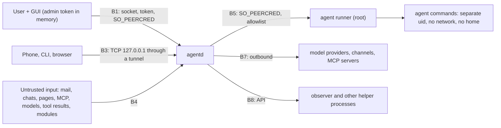

# Security model

Status: pre-alpha (0.0.1-alpha). This is a threat model of the core `agentd` and its clients. Software at this stage is not hardened for hostile environments; read section 8 before deploying. To report a vulnerability see `SECURITY.md` in the repository root.

Related: [ADR-0003](../adr/0003-api-auth.md) (tokens), [ADR-0004](../adr/0004-modules-sandbox.md) (module sandbox), [ADR-0005](../adr/0005-permissions-semantics.md) (permissions), [agentd-A-0005](../adr/agentd-A-0005-permissions-engine.md), [agentd-A-0006](../adr/agentd-A-0006-runner-packaging.md) (agent runner), [architecture](../architecture.md).

## 1. Scope and assumptions

In the model:

- the `agentd` process and its HTTP/WebSocket API (unix socket, and TCP through a tunnel);
- the agent's commands, executed under a separate unprivileged user through the agent runner;
- untrusted input to the core: mail, chats, web pages, MCP server replies, model replies, tool results, modules;
- the data directory `~/.agentos/` (database, keys, memory, backups);
- outbound network: model providers, messenger channels, tunnels, MCP;
- packaging, updates, backup and signing keys.

Out of scope for 0.x (accepted):

- **Compromise of the `agentd` process itself** (code execution inside the core). Only indirect protection exists: a small dependency set, `deny.toml`, a user unit with `NoNewPrivileges` and `ProtectSystem=strict`.
- The system administrator and root: the core and the runner trust them.
- Physical access: disk encryption is an install requirement; there is no screen lock in the kiosk compositor.
- Other processes of the same user (the user's terminal, programs): they are trusted as much as the user, because they can read files with mode `0600`, the environment of same-uid processes and, with `ptrace`, process memory.
- Multi-user operation: each user has their own core, data directory and socket; separation between users is by OS permissions.

**Key conclusion:** all processes of the same uid as the core and the GUI are trusted on par with the core, because `SO_PEERCRED` cannot distinguish processes of one uid. Everything untrusted (the agent's commands) therefore runs under a **different** uid.

## 2. Assets

| Asset | Where | Protection | Impact if leaked or altered |
|---|---|---|---|
| GUI token (`admin`) | process memory of the GUI only; passed as a descriptor | not in a file, not in the environment, a second issue is refused; `ptrace_scope=1`; ancestor check of the requester | deciding permission requests, changing permissions, logout, files, secrets, tunnels, modules, issuing tokens |
| `external`, `web`, `agent`, `module` tokens | SHA-256 only in the database; the raw value is shown once | scope not above `chat` for external clients, expiry (30 days default, 90 maximum), revocation, attempt limiter | `chat` actions from a foreign client; for `agent` and `module` limited by an allowlist |
| Provider and channel secrets | `~/.agentos/keys.env` (`0600`) or a keyring; the database holds only a reference | write-only `PUT /secrets/{ref}`, never read back, not reachable by the agent uid, excluded from backups and logs | spend on API keys, hijacked channels, messages sent in the user's name |
| `sessions.db` | `~/.agentos/` (`0600`, directory `0700`) | file permissions, disk encryption, single writer | messages, mail and chats, memory facts, the action log |
| Action log and observer findings | `sessions.db` | single write point, retention | loss of audit, rewritten history |
| Backups | `~/.agentos/export/` and external media | `age` encryption to two public keys (primary and recovery); private keys are kept off the machine | losing both private keys makes backups unreadable (accepted risk, [ADR-0007](../adr/0007-distribution-and-backup-keys.md)) |
| Project files of sessions | session working directories | the agent may write only inside the project directory | damaged or stolen project data |
| Home directory, SSH keys, data directory | the user's uid | not accessible to the agent uid | theft of the user's credentials |
| Core socket | `$XDG_RUNTIME_DIR/agentd.sock` (`0600`) | token always plus `SO_PEERCRED` (guards against other uids, not against the same uid) | control of the core |
| Agent runner | root system service | `SO_PEERCRED`, directory allowlist, fixed unit properties | compromise equals root (residual risk) |
| Provider funds and quotas | API keys | usage accounting, limits, permissions on paid actions | token spend, payments |
| The user's trust in agent actions | action log, request cards | the source of a request is shown in the card | consent given blindly to a harmful action |

## 3. Trust boundaries

| Id | Boundary | Protection |
|---|---|---|
| B1 | GUI and core over the socket | token always (`Authorization: Bearer`), `SO_PEERCRED`, GUI token only by descriptor |
| B2 | agent commands and the rest of the system | dedicated uid, transient unit with `ProtectSystem=strict`, `ProtectHome=tmpfs`, `BindPaths` to the project, `IPAddressDeny=any`, `NoNewPrivileges`, `PrivateTmp`, `MemoryMax=512M`, `TasksMax=128` |
| B3 | external clients and the core over TCP | token with scope at most `chat`, expiry, revocation, `Origin` and `Host` allowlist, limiter 5/min, disabled by default |
| B4 | **untrusted input and the core** | the `untrusted` label; external effects only through a permission request with the source shown in the card |
| B5 | core and runner | `SO_PEERCRED` on the runner socket, allowlist of directories, fixed unit properties |
| B6 | module and GUI | separate web context and network session, CSP, token of kind `module` with an allowlist |
| B7 | core and external services | keys from `keys.env` or a keyring; outbound sends go through permissions |
| B8 | core and helper processes | the same API and tokens; helpers never write to `sessions.db` ([ADR-0002](../adr/0002-db-single-writer.md)) |
| B9 | processes and disk | modes `0600`/`0700`, disk encryption, `VACUUM INTO` for backups |
| B10 | build and user | signed repository metadata, `deny.toml`, advisories check |

## 4. Threats by subsystem

### API and transport

- **Spoofing / unauthorized access.** A token is mandatory everywhere; only `GET /health` is anonymous. A token in the URL is rejected before any lookup. TCP requests are checked for `Origin` and `Host`; failed attempts are limited to 5 per minute per address (client address from `X-Forwarded-For`, right to left, trusted proxies are loopback and the tunnel address).
- **Elevation.** Scope is enforced per route (`x-scope` and `x-local-only` in the OpenAPI draft). `logout`, `files`, `secrets`, permissions and token issue are local-socket only and `admin` only. External tokens can never be `admin` (a database `CHECK` constraint).
- **Information disclosure.** Internal errors return `500 internal` without details; logs carry a request id, never message text, tokens, keys or user paths.
- **Denial of service.** Bounded queues per WebSocket subscriber; a lagging client resynchronizes from a snapshot; the write queue applies backpressure.

### Tokens

Stored as SHA-256 (hex) with metadata only; compared in constant time; shown once; revocation closes live WebSockets with `4401`. Token kinds: `gui` (admin, valid until the GUI process stops), `external` and `web` (not above `chat`; `web` may carry a `decide` scope to decide permission requests from the browser), `agent` and `module` (`chat` or lower, mandatory allowlist), `test` (test builds only). `last_used_at` is updated at most once per minute per token.

### Permissions and observer

- The effective permission is the strictest of three levels (global, persona, session). A lower level can only tighten; an attempt to loosen returns `403 permission_denied` and records an observer finding.
- "Always" changes a persona or global rule, never a session rule. The first decision wins; a repeat gets `409`. Requests expire after 10 minutes and after a core restart.
- Sending, deleting, paying and configuration default to `ask`.
- **Fail-closed:** if the observer is unavailable (for example no VRAM for the local model), dangerous actions are not executed. This is a conscious cost of safety.
- The action log is an **audit trail, not an undo**: anything sent or paid is irreversible.
- The observer reads the same untrusted text as the agent and can itself be fooled; its detection quality is not measured. It never sees keys.

### Agent command execution

- Commands are executed by the **core**, not the GUI, in its own pty under a dedicated uid, through the runner: a root service started by socket activation. It checks `SO_PEERCRED`, validates the directory against an allowlist (owned by the requester, outside `/etc`, `~/.ssh`, the data directory and the runtime directory, no `..`, no symlinks) and starts a transient unit with the properties listed under B2.
- The agent sees no runtime directory, no GUI token descriptor, no `keys.env`, no `~/.ssh`, no core socket with an `admin` token, and has no network. By design `git push` and API calls from agent commands are impossible.
- Without the runner, commands are not executed at all (fail-closed); there is no fallback outside the isolation.
- `bubblewrap` is not the primary mechanism: on distributions that restrict unprivileged user namespaces it fails without an AppArmor profile.
- Limitations: files created by the agent belong to the agent uid (ACLs or a group are needed); one uid for all projects; extending the allowlist needs an administrator.

### Database

Single writer (see [ADR-0002](../adr/0002-db-single-writer.md)): every mutation, its action-log row and its feed event are written in one transaction. File modes `0600`; WAL files too. The database holds no secrets (only `secret_ref`). Migrations take a snapshot first, and a database newer than the code refuses to start. Retention jobs and integrity checks run in the core.

### Untrusted input: mail, chats, pages, MCP, models

Everything from the outside world is labelled `untrusted`. Such text cannot grant permissions or change rules; external effects require a permission request that shows the source. Inbound mail and chats pass the observer (injection and phishing checks) before they enter the feed. Tool results, including error results, are labelled `untrusted`.

### Providers and messenger channels

Provider keys are write-only and go to `keys.env` or a keyring. Prompts and context leave the machine for cloud providers; privacy of that content is the user's decision. Outbound sends through channels go through `ask`.

### Secrets

Write-only: `PUT /secrets/{ref}` (local socket, `admin`) answers with the reference and a modification time and nothing else. `keys.env` is a plain file protected by file permissions and disk encryption; the core does not encrypt it. The secret type prints `<redacted>`. Secrets appear nowhere in logs, the diagnose report, metrics, events or the repository. A leaked secret must be rotated immediately.

### Tunnels and network exposure

TCP listens on loopback only (`127.0.0.1:4096`) and only when enabled; a tunnel (WireGuard, SSH, a reverse proxy and similar) publishes it. Some tunnel providers terminate TLS on their side and can see traffic; end-to-end tunnels do not. mTLS is not implemented. A stolen external token is valid until revoked or until expiry. Outbound connections of the core itself are not filtered.

### Schedule and triggers

Scheduled runs use the persona's permissions like any turn; a run without a session produces an event and a `202` request instead of a chat card. A trigger fires on an inbound event and is deduplicated.

### Backup and restore

Backups use `VACUUM INTO` snapshots encrypted with `age` to two recipients; `keys.env` is never included. Restore moves live files aside (`*.bak-YYYYMMDD`) instead of deleting them, and refuses while the core answers on its socket. Verification decrypts and parses an archive and reports failure as an `error` event.

### Modules

A module panel runs in its own web context with a CSP, talks to the shell through a bridge, and holds a `module` token with a method allowlist; it never receives `admin`. **The WebKit sandbox for module panels is not implemented yet.**

### Supply chain

`Cargo.lock` is committed, builds use `--locked`, the toolchain is pinned. `deny.toml` allows only permissive licenses plus MPL-2.0 and LGPL (for system GUI libraries linked dynamically), bans `openssl-sys` and `native-tls`, allows only the crates.io registry and no git dependencies, and denies yanked crates. Packages are built from a clean environment. Repository signing infrastructure and an update channel do not exist yet: install the `.deb` manually and verify it yourself.

## 5. Install requirements

- `kernel.yama.ptrace_scope=1` (shipped as a sysctl snippet in the package).
- Disk encryption for the data directory.
- The runner and observer services installed from the packaging directory and verified with the provided verify scripts.
- A dedicated system user for agent commands (created by the package's `sysusers` snippet).

## 6. What was verified and what was not

Verified in prototypes and tests: reading the GUI token file or environment as the same uid succeeds (hence the descriptor flow); the descriptor flow leaves the token out of the environment, command line and file listing and refuses a second issue; the transient unit with the dedicated uid writes only into the project directory and has no network, no home and no tokens; hash-only token storage, scope checks, `Origin`/`Host` checks and the limiter are covered by tests; the one-writer rule is covered by tests.

Not verified or not done:

- the real greeter plus kiosk compositor session on the target OS release (only prototypes on an earlier Ubuntu release);
- the WebKitGTK module sandbox and the in-GUI browser profile separation;
- behaviour behind specific tunnel providers;
- the observer's injection-detection quality with a real local model;
- core dump policy (suggestion: `LimitCORE=0` in the unit);
- reproducibility of package builds, package signing and the update channel.

## 7. Residual risks

- Code execution in `agentd` defeats most controls.
- The runner is a root service: compromise of it is root.
- A same-uid process can win the race for the GUI token if it requests it first; the ancestor check and running untrusted code under another uid close this.
- Cloud providers receive prompts.
- Losing both private backup keys makes backups unrecoverable.
- Unofficial messenger channels can get the number banned.

## 8. Before you deploy

This is pre-alpha software. Keep the core on loopback, enable a tunnel only if you understand it, issue short-lived tokens, never expose the port directly, and treat the agent as able to take any action you approve.
